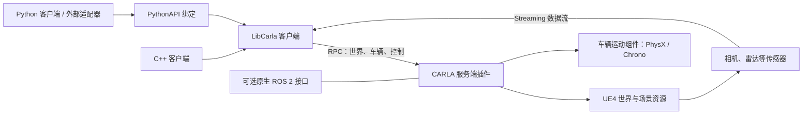

# 项目架构：CARLA + Chrono + FSAC 场景

本文依据 `/home/wuta/carla` 的目录和源码整理，核对日期为 2026-10-28。用于说明模块职责、构建与运行关系，以及本机扩展的维护入口；不作为本次运行验收报告。

## 1. 项目定位与边界

本仓库是基于 CARLA 0.9.16 的 Unreal Engine 4.26 源码工程，WUTA 维护分支为 `ue4-0.9.16`。本机在此基础上配置了 Chrono 构建、最小测试地图、FSAC 闭环赛道及红蓝黄锥桶资源。实际客户端和服务端版本应在运行时查询。

相关工程的职责如下：

| 工程或目录 | 职责 |
| --- | --- |
| `/home/wuta/carla` | 仿真服务端、客户端 API、物理集成、地图及传感器资源 |
| `/home/wuta/UnrealEngine_4.26` | 外部 UE4 引擎与编辑器，本仓库构建和运行所需 |
| `/home/wuta/miniforge3/envs/carla` | 本机 CARLA Python/构建环境，启动脚本会激活它 |
| `/home/wuta/WUTA2026_FINAL` | 外部 WUTA 自动驾驶与 ROS 2 仿真验证工程，拥有自己的启动入口和日志 |

## 2. 目录结构

```text
carla/
├── ARCHITECTURE.md                 本文
├── README.md                       上游 CARLA 项目说明
├── Makefile                        顶层构建入口
├── CMakeLists.txt                  LibCarla 的 CMake 入口
├── LibCarla/
│   ├── source/carla/
│   │   ├── client/                 C++ 客户端对象与操作接口
│   │   ├── rpc/                    客户端与服务端的数据和调用定义
│   │   ├── streaming/              传感器等数据的流式通信
│   │   ├── sensor/                 传感器数据类型及序列化
│   │   ├── geom/                   几何与坐标类型
│   │   ├── road/                   道路模型
│   │   ├── opendrive/              OpenDRIVE 解析
│   │   ├── trafficmanager/         交通车辆管理
│   │   └── ros2/                   原生 ROS 2 接口实现
│   └── cmake/                      客户端、服务端和测试构建配置
├── Unreal/CarlaUE4/
│   ├── CarlaUE4.uproject           UE4 工程与插件配置
│   ├── Config/                     UE4 项目配置
│   ├── Source/                     UE4 游戏工程源码
│   ├── Plugins/Carla/Source/Carla/  CARLA 服务端与仿真逻辑
│   ├── Plugins/CarlaTools/         编辑器与资源工具
│   └── Content/                    地图、材质、模型等 UE 资源
├── PythonAPI/
│   ├── carla/                      Python 绑定、导航 agent 和包构建
│   ├── examples/                   API 使用与传感器示例
│   ├── test/                       API 测试
│   └── docs/                       API 文档生成
├── Co-Simulation/
│   ├── Chrono/                     Chrono 车辆参数等集成资源
│   ├── CarSim/                     CarSim 集成
│   ├── PTV-Vissim/                 Vissim 协同仿真
│   └── Sumo/                       SUMO 协同仿真
├── Util/BuildTools/                上游构建、依赖、打包和资源工具
├── Build/                         本机脚本、依赖安装、生成资源及检查记录
├── Import/                        外部资源导入暂存与说明
├── Examples/                      C++ 客户端示例
├── Docs/                          上游使用和开发文档
└── osm-world-renderer/             OSM 地图相关工具
```

`Build/` 具有双重用途：上游构建过程把依赖与中间产物放在这里，本机也把手写配置脚本放在这里。维护时应逐项识别内容，不能把整个目录视为可随时删除的缓存。

## 3. 核心运行关系



PythonAPI 大部分世界和车辆操作最终进入 LibCarla；UE4 内的 CARLA 插件执行服务端操作，管理 Actor、车辆、传感器和世界状态。地图与材质由 UE4 Content 资源提供。

| 功能 | 主要源码入口 |
| --- | --- |
| Python 模块装配 | [libcarla.cpp](PythonAPI/carla/source/libcarla/libcarla.cpp) |
| 客户端世界操作 | [World.cpp](LibCarla/source/carla/client/World.cpp) |
| 客户端车辆与 Chrono 请求 | [Vehicle.cpp](LibCarla/source/carla/client/Vehicle.cpp) |
| 服务端 RPC 处理 | [CarlaServer.cpp](Unreal/CarlaUE4/Plugins/Carla/Source/Carla/Server/CarlaServer.cpp) |
| 仿真世界管理 | [CarlaEpisode.cpp](Unreal/CarlaUE4/Plugins/Carla/Source/Carla/Game/CarlaEpisode.cpp) |
| UE4 车辆 Actor | [CarlaWheeledVehicle.cpp](Unreal/CarlaUE4/Plugins/Carla/Source/Carla/Vehicle/CarlaWheeledVehicle.cpp) |
| Chrono 车辆运动组件 | [ChronoMovementComponent.cpp](Unreal/CarlaUE4/Plugins/Carla/Source/Carla/Vehicle/MovementComponents/ChronoMovementComponent.cpp) |
| 原生 ROS 2 实现 | [ROS2.cpp](LibCarla/source/carla/ros2/ROS2.cpp) |

存在 ROS 2 或 Chrono 源码只说明工程具备相应实现；是否编译、启用及实际生效，需要分别检查构建配置、启动参数、车辆设置和运行日志。

## 4. 构建与运行入口

顶层 [Makefile](Makefile) 按平台引入 `Util/BuildTools/Linux.mk` 或 Windows 构建规则。顶层 CMake 引入生成的 `Build/CMakeLists.txt.in` 后构建 LibCarla，因此依赖准备是构建链的一部分。

本机 [build-chrono.sh](Build/build-chrono.sh) 的执行顺序为：

```text
激活 Conda carla 并设置编译选项
  → make setup ARGS='--chrono'
  → 构建 LibCarla client/server release
  → 构建 OSM2ODR
  → 重建 PythonAPI
  → 构建 UE4 工程，启用 Chrono、禁用 SimReady
```

| 本机入口 | 行为 |
| --- | --- |
| [prepare-content.sh](Build/prepare-content.sh) | 准备 CARLA 内容资源 |
| [run-chrono.sh](Build/run-chrono.sh) | 激活 Conda、配置 NVIDIA 环境、检查 2200 端口并启动 UE4Editor 游戏模式 |
| [run-fsac.sh](Build/run-fsac.sh) | 选择 FSACLoop，默认打开窗口，再调用 `run-chrono.sh` |
| [stop-chrono.sh](Build/stop-chrono.sh) | 按固定引擎路径、地图和端口匹配本项目服务端，发送 SIGTERM |
| [chrono-smoke.py](Build/chrono-smoke.py) | 创建 Audi TT，调用 `enable_chrono_physics`，执行短时同步控制测试并写出结果 |

当前启动约定：

| 配置项 | 含义 |
| --- | --- |
| `UE4_ROOT` | 引擎目录；启动前需提供，例如 `/home/wuta/UnrealEngine_4.26` |
| `CARLA_UE4_ROOT` | CARLA 根目录；本机为 `/home/wuta/carla` |
| `CARLA_MAP` | `run-chrono.sh` 默认 `/Game/ChronoTest/ChronoFlat`；`run-fsac.sh` 设置为 FSACLoop |
| `CARLA_VISIBLE=1` | 打开 1280×720 窗口；默认普通启动使用离屏渲染 |
| `CARLA_PHYSICS_ONLY=1` | 使用 `-nullrhi`，优先于可见窗口选项，不提供正常相机渲染 |
| 2200 / 2201 / 2202 | RPC / streaming / secondary 端口，当前启动脚本固定指定 |

打开 FSAC 场景的本机命令：

```bash
env UE4_ROOT=/home/wuta/UnrealEngine_4.26 \
    CARLA_UE4_ROOT=/home/wuta/carla \
    bash /home/wuta/carla/Build/run-fsac.sh
```

`run-chrono.sh` 和 `run-fsac.sh` 负责启动世界，车辆动力学由客户端单独选择。Chrono 短测使用 [官方 sedan 参数](Co-Simulation/Chrono/Vehicles/sedan)；这组参数与 Audi TT 外观及 WUTA 赛车标定是不同层面的配置。

## 5. 自定义地图与锥桶资源

本机 UE4 资源集中在 [Content/ChronoTest](Unreal/CarlaUE4/Content/ChronoTest)：

| 资源 | 用途 |
| --- | --- |
| `ChronoFlat.umap` | 最小平面测试地图 |
| `FSACLoop.umap` | FSAC 闭环赛道场景 |
| `OpenDrive/` | 自定义地图的 OpenDRIVE 道路数据 |
| `SM_FSACRoad.uasset` | FSAC 路面网格 |
| `M_ChronoAsphalt.uasset`、`M_FSACApron.uasset` | 沥青路面及外围地面材质 |
| `M_DaylightSky.uasset`、`MinimalWeather.uasset` | 天空与天气资源 |
| `Cones/` | 红、蓝、黄色锥桶模型和材质 |
| `SingleVehicleFactory.uasset`、`SingleVehicleGameMode.uasset` | 最小车辆注册与游戏模式 |

赛道资源生产链为：

```text
Build/generate-fsac-track.py
  → Build/fsac-track/track.json、validation.json
  → FSAC_Road.obj、FSACLoop.xodr、track-layout.png
  → 在 UE4 编辑器环境运行 Build/install-fsac-track.py
  → 导入路面、布置锥桶和出生点、保存 FSACLoop.umap
```

生成目录内的 `FSACLoop.xodr` 与 UE4 `Content/ChronoTest/OpenDrive/` 中的运行资源需要保持一致。当前安装脚本主要处理网格与关卡，不自动承担生成 XODR 到运行目录的复制。

当前 [track.json](Build/fsac-track/track.json) 的几何记录为单圈约 399.16 m、宽 3.5 m、最长直线约 58.18 m、发夹弯外径 17.5 m、268 个锥桶。它按用户提供的 D9.2 条款进行几何检查；记录中的 3 圈参数不等于运行时已完成 3 圈。

锥桶资源链为：

```text
STEP CAD 模型
  → Build/convert-cone.py（gmsh 网格化、转为 Z 向上及 UE 厘米单位）
  → Build/cone-assets/SM_TrackCone.obj
  → 在 UE4 编辑器环境运行 Build/import-cones.py
  → Content/ChronoTest/Cones/ 下的模型与红蓝黄材质
```

`convert-cone.py` 当前读取 `/home/wuta/下载/黄色小锥桶.STEP`；仓库根目录另有同名文件，修改来源时应核对实际脚本路径。当前快速说明记录的白色条带为从锥桶顶部沿斜边向下 6–14 cm。白色材质的视觉效果与真实反光性能需要分别验证。

创建最小地图使用 `create-chrono-flat.py`，车辆注册使用 `configure-single-vehicle.py`；`fix-asphalt-texture.py`、`fix-daylight.py`、`fix-scene-appearance.py` 用于本机材质和光照调整。这些导入、建图和材质脚本依赖 UE4 的 `unreal` Python 模块，应在编辑器环境中执行。

坐标与单位应在生成和导入两端保持一致：CARLA API 使用米，UE4 资源和 Actor 位置使用厘米；赛道生成器对 OpenDRIVE 的 Y 做反射，安装脚本还处理 OBJ 导入的 Y 反射。调整任一转换后需同时检查路面、锥桶、出生点和道路数据是否重合。

## 6. 与 WUTA 自动驾驶系统的连接

本机外部工程 `/home/wuta/WUTA2026_FINAL/start_wuta_sim_validation.sh` 提供 ROS 2 仿真验证入口，并转入 `tools/run_wuta_sim_validation.py`。脚本加载 ROS 2 Humble 和该工程自己的工作空间；选择 CARLA 后不加载 WUTA-SIM overlay。

系统职责关系如下，具体传感器、话题和节点选择以外部工程配置为准：

```text
本仓库：地图、车辆、动力学和模拟传感器
  → 外部 CARLA 适配与 ROS 2 数据接口
  → WUTA 感知、融合、定位/建图、规划与控制
  → CARLA 车辆控制接口
```

RViz 配置、融合节点选择、控制器及比赛状态机属于 WUTA 工程的维护范围。仅启动本仓库的 `run-fsac.sh` 不会同时启动这些节点。原生 CARLA ROS 2 接口与外部适配器是不同接入方式，需要核对实际运行链路。

## 7. 产物管理与验证边界

| 目录或文件 | 内容与维护要求 |
| --- | --- |
| `Build/*-install/`、`Build/*-build*/` | 第三方依赖、安装结果和编译中间产物 |
| `Build/cone-assets/`、`Build/fsac-track/` | CAD/赛道生成的中间资源与几何报告 |
| `Build/config-logs/` | 导入检查、短测结果等本机证据 |
| `Unreal/CarlaUE4/Saved/` | UE4 日志及运行生成内容 |
| `Content.tar.gz` | 本机资源归档，不属于业务源码 |

根目录 `.gitignore` 忽略 `Build`，UE4 配置忽略 `Content`。本分支明确纳入部分自定义脚本、赛道 JSON、CAD 来源和 ChronoTest 资源；新建的同目录文件仍默认被忽略，需逐项检查并纳入版本管理。第三方依赖、CARLA 官方内容包、编译产物和运行日志不包含在仓库中。路径、引擎、依赖和内容包的准备方式见 [本机资源说明](WUTA-SETUP.md)。

[CHRONO-QUICKSTART.md](Build/CHRONO-QUICKSTART.md) 保存了历史短测说明。本次文档整理只核对文件与源码，没有重新构建或运行仿真。验收时应分别确认：

1. 构建成功且客户端、服务端版本兼容。
2. 地图、材质、锥桶与模拟传感器输出正确。
3. 车辆实际启用 Chrono，并核对服务端日志中的加载或回退信息。
4. WUTA ROS 2 链路、规划与控制持续工作。
5. 根据圈数、比赛状态、碰撞和最终日志判断完整闭环是否完成。

短时车辆移动、ROS 话题有数据或 RViz 成功打开，都只能证明对应环节已工作。
